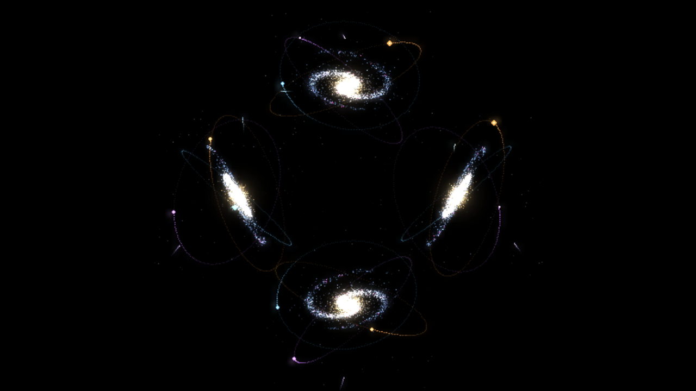

# Holo – holograficzna galaktyka

Program na Raspberry Pi, który wyświetla animowaną galaktykę 3D przeznaczoną do
projekcji „holograficznej” (efekt **Pepper's ghost**): obraz z monitora odbija się
w przezroczystej piramidzie lub szybie i wydaje się unosić w powietrzu.



Na ekranie:
- spiralna galaktyka z kilku tysięcy gwiazd, obracająca się i powoli kołysząca,
- pulsujące jądro i poświata,
- trzy świecące ciała na nachylonych orbitach, z ogonami,
- przelatujące komety i migoczące gwiazdy tła.

W trybie **pyramid** każda z 4 ścianek pokazuje galaktykę z innej strony, więc
obchodząc piramidę, widzisz ją naprawdę w 3D.

## Uruchomienie na komputerze (do testów)

```bash
python3 -m venv .venv
.venv/bin/pip install -r requirements.txt
.venv/bin/python -m holo --windowed
```

## Uruchomienie na Raspberry Pi

Na Raspberry Pi OS (z pulpitem):

```bash
sudo apt update
sudo apt install -y git python3-pygame python3-numpy
git clone <adres-repozytorium> holo
cd holo
python3 -m holo
```

Program startuje na pełnym ekranie. Wyjście: `Esc` albo `q`.

Jeśli animacja jest za wolna (sprawdź klawiszem `f`), zmniejsz obciążenie:

```bash
python3 -m holo --render-scale 0.45 --stars 4000
```

## Klawisze

| Klawisz | Działanie |
|---|---|
| `Esc` / `q` | wyjście |
| `spacja` | pauza |
| `m` | przełącz tryb pyramid ↔ single |
| `↑` / `↓` | nachylenie galaktyki |
| `+` / `-` | prędkość animacji |
| `g` | poświata wł./wył. |
| `f` | licznik FPS |

## Opcje

`python3 -m holo --help` pokazuje wszystkie. Najważniejsze:

| Opcja | Opis |
|---|---|
| `--mode pyramid\|single` | 4 widoki pod piramidę albo 1 widok pod pojedynczą szybę |
| `--flip` | odwraca obraz, gdy w odbiciu galaktyka jest do góry nogami |
| `--gap 0.3` | wielkość pustego środka (miejsce na czubek piramidy) |
| `--tilt 30` | nachylenie galaktyki w stopniach |
| `--stars 6000` | liczba gwiazd |
| `--arms 2` | liczba ramion spiralnych |
| `--render-scale 0.6` | rozdzielczość renderowania (mniej = szybciej) |
| `--windowed` | okno zamiast pełnego ekranu |

## Jak zbudować piramidę

Monitor kładziesz ekranem do góry, a na jego środku stawiasz odwróconą piramidę
(czubkiem w dół) z przezroczystego plastiku (PET, plexi). Ścianki powinny być
nachylone pod kątem 45°. Pokój powinien być zaciemniony, bo czarne tło
obrazu jest wtedy niewidoczne i zostaje tylko „unosząca się” galaktyka.

## Struktura kodu

```
holo/
  main.py      – pętla główna, klawisze, składanie widoków
  config.py    – opcje i argumenty linii komend
  scene.py     – galaktyka, orbity, komety (obliczenia 3D)
  camera.py    – rzutowanie 3D → 2D
  renderer.py  – rysowanie jednego widoku (gwiazdy, poświata, jądro)
  layout.py    – ułożenie widoków na ekranie (piramida / pojedynczy)
```
